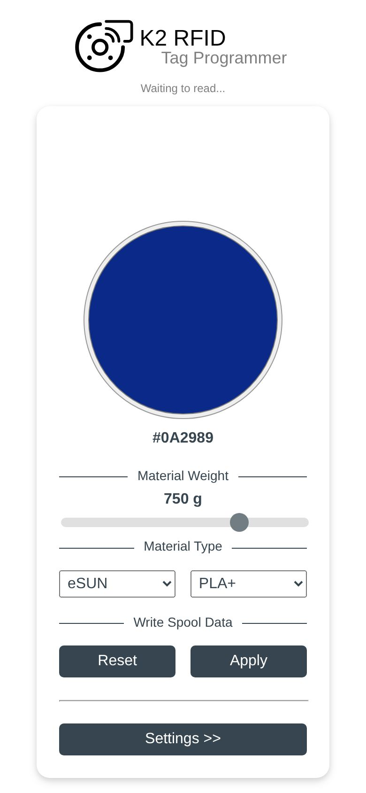
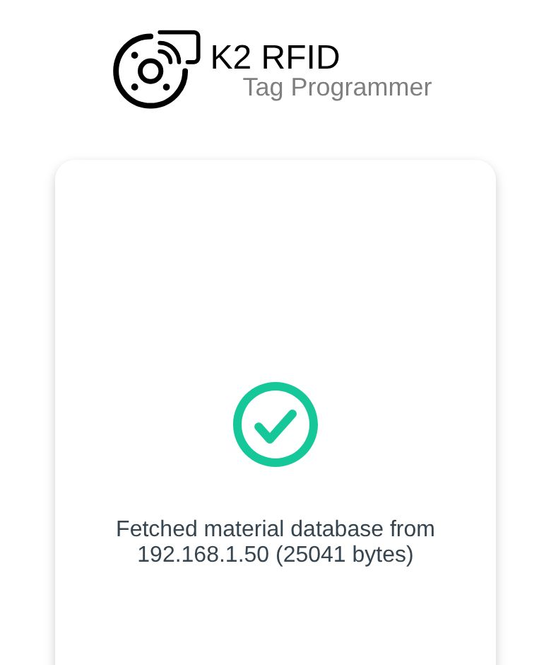
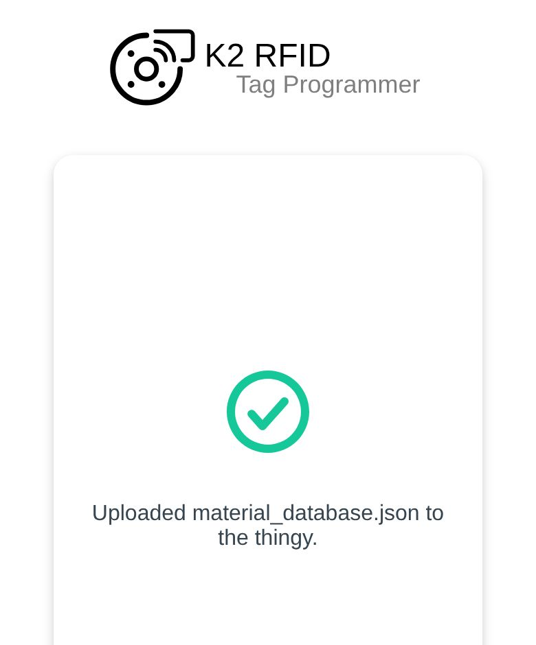
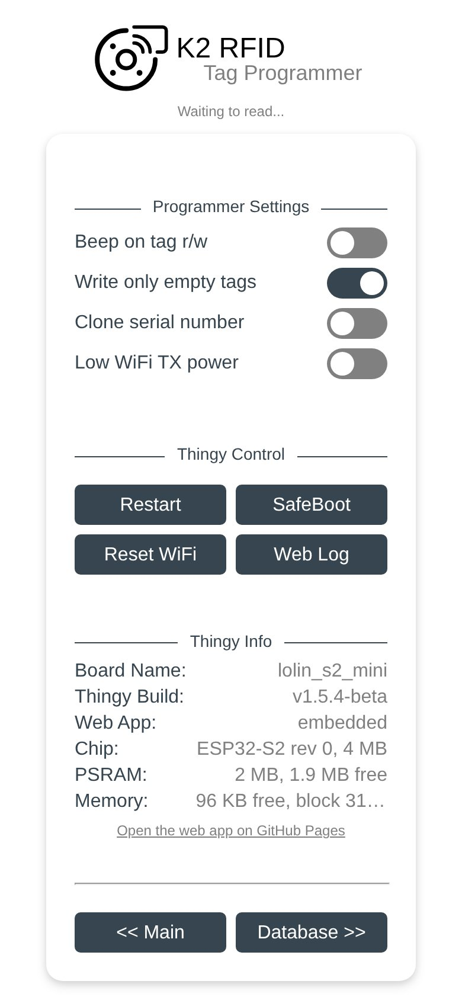
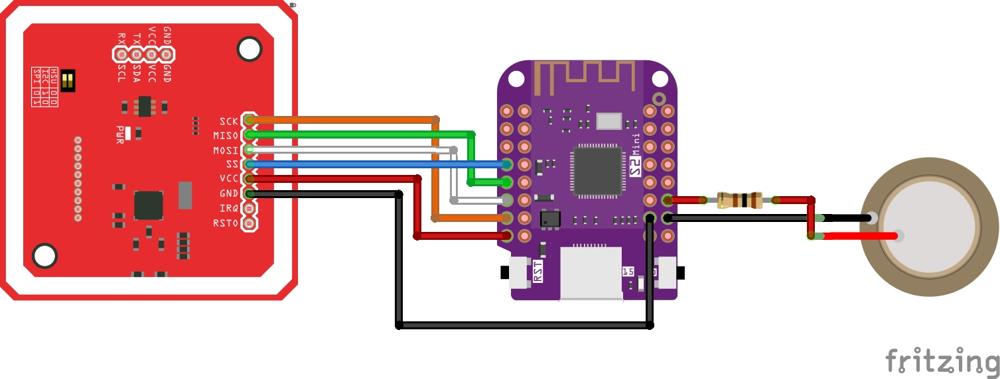
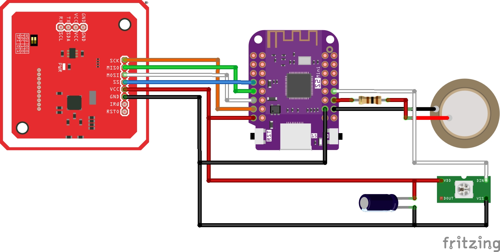

# K2-RFID
 
Web app controlled and esp32-powered K2/CFS RFID programming thingy based on [DnG-Crafts/K2-RFID](https://github.com/DnG-Crafts/K2-RFID).

## Why do I need it?

Creality's K2-series printers (K2, K2 Pro, K2 Plus) and the Creality Hi support 1k MIFARE tags to identify the spool's material and color.
As the tagged spools from Creality come with an additional price and also to retrofit older Creality or non-Creality spools, you could use this tool to simply write your own tags, add two of them per spool and enjoy the magic of automatically identified materials.

## What do I need to make one?

Essential components:
- esp32 microcontroller board (tested with a [Wemos S2 mini board](https://www.wemos.cc/en/latest/s2/s2_mini.html))
- PN532 NFC/RFID board
- MIFARE classic 1k tags

Optionally:
- housing (available on [Printables](https://www.printables.com/model/1284434-k2-rfid-box) or [CrealityCloud](https://www.crealitycloud.com/model-detail/68165e11f8576ee3f90c7d2b?source=61))
- WS2812b RGB LED (and ~1µF capacitor)
- piezo disk (and ~100 Ohm resistor)

Very optionally:
- battery
- charger
- switch
- ...

## How to use it?

Once you have programmed your esp32, connected it to the PN532 NFC/RFID board, and supplied it with power, a new access point (with SSID: K2RFID) will appear on your computer or phone. Set the WiFi credentials for your home network (or set it to AP-mode). After a restart of the device, just visit K2RFID.local. Here you can read and write the tags. Afterwards just put two of them (obviously with identical content) to a spool and load it into your printer's CFS.

### Web App (GitHub Pages)

The same web app is also available at **https://soylentorange.github.io/K2-RFID/** and can be installed as an app (PWA) from there. Enter the address of your thingy (`k2rfid.local` or its IP address) in the settings and allow access to devices on your local network when your browser asks for it.

Note: Talking from an https page to a device on your local network only works in Chromium-based browsers (Chrome, Edge, ...) with [Local Network Access](https://developer.chrome.com/docs/modern-web-guidance/guides/security/local-network-access). Safari (and thus every browser on iOS) and Firefox block it. In that case simply use the web app served by the thingy itself at http://k2rfid.local - it is the very same app. The settings of the app served by the thingy also contain a link to the GitHub Pages version.

<p align="center">
    
</p>

### Select Material Settings via UI

Just select the color by hitting the large color circle to select the color of choice (or select one the the known - at least known to me - standard colors), the type of material and the amount of material on the spool. After hitting the `Apply` button, the programmer is armed and will wait for tags to write the content. A serial number is auto-generated and will be used for all subsequent writes. A new serial number is genereted whenever you hit the `Apply` button again.

The material is chosen by brand and type. The brands come from the material database, so with a database copied from your printer you'll also find e.g. eSUN or Polymaker materials (and your own presets) next to Creality and Generic.

The web interface remembers your last selection (color, brand, material and weight) in your browser, so it is pre-selected the next time you open it. Hitting `Reset` goes back to the default (Generic PLA, black, 1000 g).

<p align="center">
    
</p>

### Copy/Clone Tag

Once a tag is read, just click the toast notification and it will make the content (color, material, weight, and serial number - in case `clone serial number` is active in the settings) of the tag available for writing. Just hit the `Apply` button to arm the programmer.

### Safeguarding existing Tags

By default, only empty tags are written. When you want to re-program tags, disable the `Write only empty tags` checkbox in the settings.

### Verified Writing

After writing, the programmer re-authenticates with the tag's (new) key, reads the data back and compares it with what should have been written. Only when this check passes, the success beep sounds and the LED signals a written tag. If a write fails (e.g. because the tag was just entering or leaving the reader's field), the programmer silently retries while the tag stays on the reader. A tag where a write attempt failed is written again even if `Write only empty tags` is active, since a partially written tag isn't empty anymore. After repeated failures, an error is signalled (error beep / LED); remove the tag and present it again to retry.

### Future Materials

As of now, a fixed set of materials (defined by the K2 Plus's firmware) is known to the programmer. You can update the list in the settings in two ways:

- `Update Database`: The programmer logs into your printer via SSH (as `root`), downloads its material database (`/mnt/UDISK/creality/userdata/box/material_database.json`, which also contains your custom materials) and saves it. The printer compresses the file before sending (`gzip`), so only ~25 KB are transferred and stored. If that fails, it falls back to the default database older printer firmware provides via http (`http://PRINTER_IP/downloads/defData/material_database.json`). No warranty that future firmware updates might break this behaviour...
- `Upload Database`: Select a `material_database.json` file from your computer or phone. The file is checked, compressed in your browser and saved onto the programmer.

The printer used by `Update Database` is set in the `Printer` section of the settings:

- Enter the printer's IP address, or hit `Search` to find a K2, K2 Pro, K2 Plus or Hi on your local network (the result is saved right away).
- Enter the root password of your printer, if it isn't the default `creality_2024`. Leave the field empty to keep the saved password.
- `Save Printer` stores address and password on the programmer. If no printer is set, `Update Database` searches for one first.

Note: The password is stored on the programmer (unencrypted, in its preferences) and never sent back to the browser. The printer's SSH host key is not verified.

| Search printer | Update Database | Upload Database |
| :---: | :---: | :---: |
|  |  |  |

To copy the database manually (e.g. for `Upload Database`):

```
scp -O root@PRINTER_IP:/mnt/UDISK/creality/userdata/box/material_database.json .
```

The `-O` option makes scp use the legacy SCP protocol, as the printer has no SFTP server (without it, scp fails with `sftp-server: not found`).

This file is also the one containing custom materials you have added to your printer.

<p align="center">
    
</p>

## Device Feedback

I've added a most annyoing beeper to the programmer. You can switch it off in the settings.

### LED

On boards with an onboard LED the current state and events are shown via the LED.

#### RGB_BUILTIN

On boards with an onboard RGB-LED or with an external WS2812b, different colors are used: 

- Serving captive portal (connect to enter credentials):
  - rapidly blinking white

- Waiting for network connection:
  - blinking white

- Connected to WiFi (or in AP-mode) and waiting to read tags:
  - dim solid blue

- Tag read:
  - flashing blue

- Armed to write tags:
  - breathing green

- Armed to write and re-write tags:
  - breathing red

- Tag written:
  - flashing red/green

Note: just make sure that the RGB_BUILTIN_LED_COLOR_ORDER is set matching your board. Otherwise the colours will look strange.

#### LED_BUILTIN

On boards with an onboard mono-color LED: 

- Serving captive portal (connect to enter credentials):
  - blinking rapidly

- Waiting for network connection:
  - blinking

- Connected to WiFi (or in AP-mode) and waiting to read tags:
  - dim solid

- Tag read:
  - flashing

* Armed to write tags:
  * breathing

- Armed to write and re-write tags:
  - breathing quickly

- Tag written:
  - flashing

## Web logging

Even though there is no button for it, if you open k2rfid.local/weblog, you'll see a logging window. For every tag being read it will show a hex and ascii dump of the data on the tag.

<p align="center">
    
</p>

## Build instructions

### Assembly

Essentially required are only the ES32 and a PN532 board. For some audible feedback, I've added a 27 mm pizo disc and a 100 Ohm resistor (on pin 16).

Connect the PN532 board pins to:

| PN532        | ESP           | 
| ------------- |:-------------:| 
| SCK      | 12 |
| MOSI      | 11      | 
| SS | 7     |
| MISO | 9|

Don't forget the ground line and connect PN532's VCC to the 3.3 V regulator output of the ESP board.

Note: The PN532 needs to be set to SPI-mode. On my board, there is a DIP switch that needed ajustment as it came in UART-mode. Look for the print on the PCB and adjust the switches accordingly (I needed to toggle SW2 to 1).


<p align="center">
    
</p>

#### Adding an external RGB-LED

I found an old RGB LED-strip in my pile of junk. cutting one of the LEDs from the strip, it could just be added to the board (at pin 18, an additional buffer capacitor stabilizes the output of the 3.3V regulator on the S2 mini board).

<p align="center">
    
</p>

### Flashing Firmware

The easiest way to get the firmware on the board is using [esptool.py](https://github.com/espressif/esptool). After [installing](https://docs.espressif.com/projects/esptool/en/latest/esp32/installation.html#installation) esptool.py and downloading the factory firmware image matching your setup from the [releases-section](https://github.com/soylentOrange/K2-RFID/releases), upload it to the board (using the usb port of your board) with: `esptool write-flash 0x0 ADJUST_TO_YOUR_PATH/lolin_s2_mini.firmware.factory.bin` (esptool versions before v5 use `esptool.py write_flash` instead). 

Note: When uploading to a factory fresh board, you might need to enable uploads by pressing both buttons, release the "0"-button first, then the "RST"-button (this sequence will enable the USB-CDC). 

#### Rebuilding the Firmware before Upload

If you want to rebuild the firmware yourself before uploading, you'll need to have [PlatformIO](https://platformio.org/platformio-ide) (and [esptool.py](https://github.com/espressif/esptool)).

For building the web app you also need [Node.js](https://nodejs.org/) (version 20.19 or newer). The npm packages (see `web/package.json`) are installed automatically into `web/node_modules` on the first build - no global packages needed anymore.

Then clone the repository, open it in [Visual Studio Code](https://code.visualstudio.com/), possibly adjust the `platformio.ini` to your likings and build it for your board. After a (successful) build, you can flash it using esptool (a hint on the command line is given after building).  

What happens during a build:

- `tools/build_web.py` installs the npm packages (`npm ci` in `web/`, only when needed), builds the web app (`npm run build:device`) and minifies the web log page (`assets/embed_html/webserial.html`). Both are gzipped into `.pio/embed/` and embedded into the firmware.
- `tools/compress_data.py` gzips the files of `assets/data` for the LittleFS image.
- For the factory image (`firmware.factory.bin`), `safeboot/tools/factory.py` also builds the SafeBoot project in `safeboot/`. Its website is minified with a global `html-minifier-terser` if you have one, otherwise with the one installed in `web/node_modules`.
- `tools/version.py` derives the version from the git branch/tag. In detached HEAD state (e.g. in CI), set the environment variable `REF_NAME` to the branch or tag name.

#### Continuous Integration

GitHub Actions build every push and pull request:

- `.github/workflows/firmware.yml` builds the firmware (including the factory image) for `lolin_s2_mini`, `lolin_s2_mini_extled` and `esp32_s3_tiny` and provides the binaries as artifacts.
- `.github/workflows/release.yml` publishes a release. Add a `## vX.Y.Z` section to `CHANGELOG.md` and bump `APP_VERSION` in `platformio.ini`, then start the workflow under *Actions → Release → Run workflow* with the version (e.g. `v1.2.0`). It builds all boards, creates the tag and the release with the notes from `CHANGELOG.md`, and attaches `<board>.firmware.factory.bin` (for esptool) and `<board>.firmware.bin` (for OTA/SafeBoot updates).
- `.github/workflows/pages.yml` builds the web app and, on `main`, publishes it on GitHub Pages.
- Dependabot (`.github/dependabot.yml`) proposes updates for the npm packages and GitHub Actions monthly. PlatformIO libraries (`lib_deps` in `platformio.ini`) are pinned and need to be updated by hand.

### Developing the Web App

The web app lives in [`web/`](web/) and is built with [Vite](https://vite.dev/) from plain JavaScript modules - no framework:

| File | Purpose |
| --- | --- |
| `web/index.html` | markup of all views (main, settings, progress) |
| `web/src/main.js` | UI logic and the websocket protocol of the thingy |
| `web/src/device.js` | connection to the thingy (http + websocket, reconnects, heartbeat) |
| `web/src/materials.js` | material database parsing |
| `web/src/printer.js` | printer discovery and database download |
| `web/src/style.css` | styles |

One source, two builds:

- `npm run build:device` creates a single self-contained html file that is gzipped and embedded into the firmware (done automatically by `tools/build_web.py` when building with PlatformIO).
- `npm run build:pages` creates the static site for GitHub Pages in `web/dist` (done by the GitHub Action in `.github/workflows/pages.yml` on every push to `main`).

Images, icons and the manifest are shared with the thingy's file system (`assets/data`).

For development without hardware, there is a small mock of the thingy:

```sh
cd web
npm install
npm run build:device && npm run mock   # embedded app on http://localhost:8080/
npm run dev                            # dev server, open http://localhost:5173/?device=localhost:8080
```

The screenshots in `assets/doc/Screenshot_*.jpeg` were taken with [Playwright](https://playwright.dev/) against this mock.

To host the web app from your own fork, change `PAGES_URL` in `web/vite.config.js` and `CORS_ALLOW_ORIGIN` in `platformio.ini` and set *Settings > Pages > Source* to *GitHub Actions*.

## Acknowledgements

* This project is based the project [DnG-Crafts/K2-RFID](https://github.com/DnG-Crafts/K2-RFID). I redesigned the website to my likings, and completely re-wrote the esp32 code. 

* The app icon is modified from [Solar Icons](https://www.figma.com/community/file/1166831539721848736?ref=svgrepo.com) in CC Attribution License via [SVG Repo](https://www.svgrepo.com/).

* The favicon was prepared according (loosely) the guide [How to Favicon in 2025](https://evilmartians.com/chronicles/how-to-favicon-in-2021-six-files-that-fit-most-needs). 

* Creating svgs with Inkscape leaves a lot of clutter in the file, [svgo](https://github.com/svg/svgo) helps.

* The Toast notifications of the web log are made with [Toastify](https://github.com/apvarun/toastify-js).

* The material database is fetched via SSH with [LibSSH-ESP32](https://github.com/ewpa/LibSSH-ESP32).

* The formula for generating the breathing LED was found in a post at [ThingPulse](https://thingpulse.com/breathing-leds-cracking-the-algorithm-behind-our-breathing-pattern).
