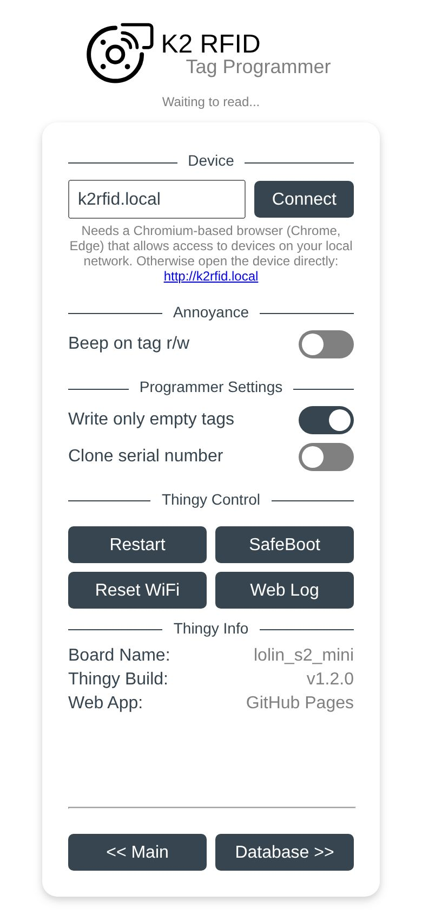
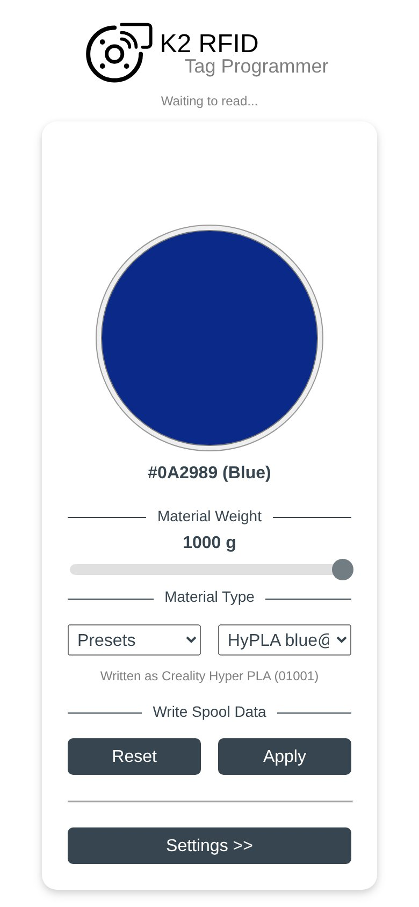
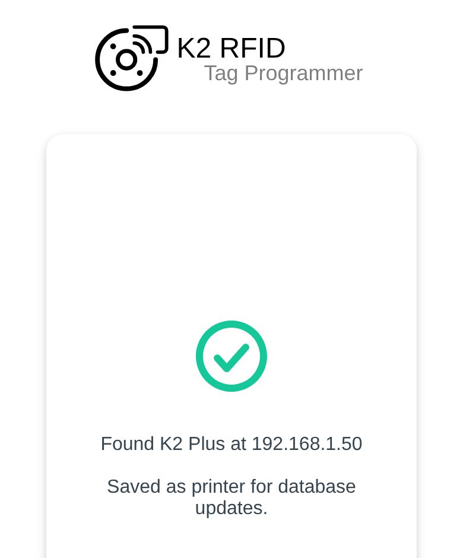
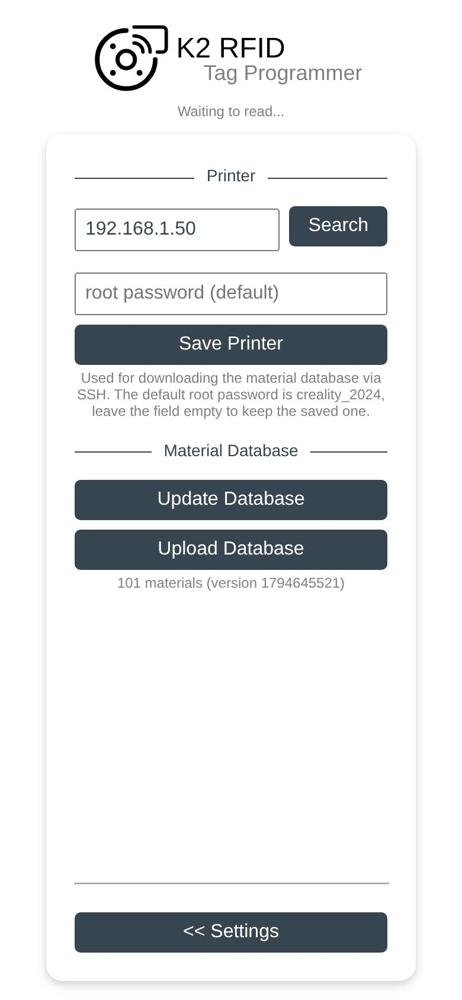
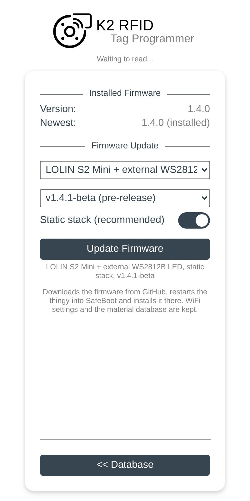
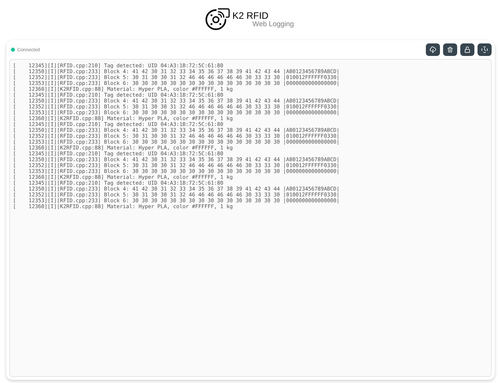
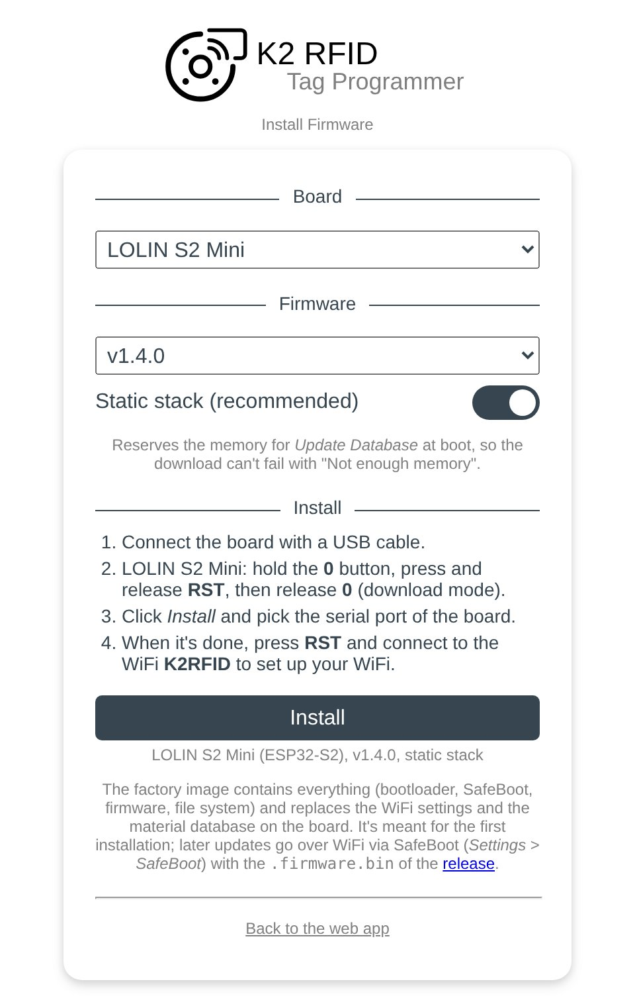

# K2-RFID
 
Web app controlled and esp32-powered K2/CFS RFID programming thingy.

## Why do I need it?

Creality's K2-series printers (K2, K2 Pro, K2 Plus and the related models F025, GS-04 and Z2) and the Creality Hi support 1k MIFARE tags to identify the spool's material and color.
As the tagged spools from Creality come with an additional price and also to retrofit older Creality or non-Creality spools, you could use this tool to simply write your own tags, add two of them per spool and enjoy the magic of automatically identified materials.

## What do I need to make one?

Essential components:
- esp32 microcontroller board (tested with a [Wemos S2 mini board](https://www.wemos.cc/en/latest/s2/s2_mini.html))
- PN532 NFC/RFID board
- MIFARE classic 1k tags

Optionally:
- housing (available on [Printables](https://www.printables.com/model/1284434-k2-rfid-box) or [CrealityCloud](https://www.crealitycloud.com/model-detail/68165e11f8576ee3f90c7d2b?source=61))
- WS2812b RGB LED (and ~1µF capacitor)
- piezo disk (and ~100 Ohm resistor)

Very optionally:
- battery
- charger
- switch
- ...

## How to use it?

Once you have programmed your esp32, connected it to the PN532 NFC/RFID board, and supplied it with power, a new access point (with SSID: K2RFID) will appear on your computer or phone. Set the WiFi credentials for your home network (or set it to AP-mode). After a restart of the device, just visit K2RFID.local. Here you can read and write the tags. Afterwards just put two of them (obviously with identical content) to a spool and load it into your printer's CFS.

### Web App (GitHub Pages)

The same web app is also available at **https://soylentorange.github.io/K2-RFID/** and can be installed as an app (PWA) from there. Enter the address of your thingy (`k2rfid.local` or its IP address) in the settings and allow access to devices on your local network when your browser asks for it.

Note: Talking from an https page to a device on your local network only works in Chromium-based browsers (Chrome, Edge, ...) with [Local Network Access](https://developer.chrome.com/docs/modern-web-guidance/guides/security/local-network-access). Safari (and thus every browser on iOS) and Firefox block it. In that case simply use the web app served by the thingy itself at http://k2rfid.local - it is the very same app. The settings of the app served by the thingy also contain a link to the GitHub Pages version.

<p align="center">
    
</p>

### Select Material Settings via UI

Just select the color by hitting the large color circle to select the color of choice, the type of material and the amount of material on the spool. After hitting the `Apply` button, the programmer is armed and will wait for tags to write the content. A serial number is auto-generated and will be used for all subsequent writes. A new serial number is genereted whenever you hit the `Apply` button again.

The material is chosen by brand and type. The brands come from the material database: Creality, Generic, eSUN and Polymaker are included by default, and with a database copied from your printer you'll also find your own presets.

A database copied from your printer also contains the filament presets you created in Creality Print (e.g. `HyPLA blue@K2 Plus 0.4 nz - RW`, or custom filaments of other brands such as `JAYO PETG ...`). They are listed in their own category `User Presets`, each name once. A preset is only a label: the tag stores the material id, not the preset, so it's written as the material the preset is based on, which is shown in the heading above the selection (e.g. `Written as Creality Hyper PLA`). The printer then shows the spool as that material.

<p align="center">
    
</p>

The color dialog offers the official colors of the selected material as presets (e.g. the 30 colors of Creality Hyper PLA, as in Creality Print). When you pick one of them, its name is shown next to the hex value, e.g. `#C12E1F (Red)`. The colors are taken from the material database on the thingy; the official colors of the Creality filaments are also built into the web app, in case the database doesn't list them (e.g. an older database that is still stored on your thingy). Materials without colors of their own get the Hyper PLA colors. Any other color can still be chosen freely.

The web interface remembers your last selection (color, brand, material or preset and weight) in your browser, so it is pre-selected the next time you open it. Hitting `Reset` goes back to the default (Generic PLA, black, 1000 g).

<p align="center">
    
</p>

### Copy/Clone Tag

Once a tag is read, just click the toast notification and it will make the content (color, material, weight, and serial number - in case `clone serial number` is active in the settings) of the tag available for writing. Just hit the `Apply` button to arm the programmer.

### Safeguarding existing Tags

By default, only empty tags are written. When you want to re-program tags, disable the `Write only empty tags` checkbox in the settings.

### Verified Writing

After writing, the programmer re-authenticates with the tag's (new) key, reads the data back and compares it with what should have been written. Only when this check passes, the success beep sounds and the LED signals a written tag. If a write fails (e.g. because the tag was just entering or leaving the reader's field), the programmer silently retries while the tag stays on the reader. A tag where a write attempt failed is written again even if `Write only empty tags` is active, since a partially written tag isn't empty anymore. After repeated failures, an error is signalled (error beep / LED); remove the tag and present it again to retry.

### Read Errors

If a tag can't be read (e.g. because it was just entering or leaving the reader's field), the programmer silently reads it again, up to three times. Only if that doesn't help, or if the tag doesn't hold valid spool data, an error is signalled: the error beep sounds, the LED blinks red (or rapidly) for a moment, and the web app shows a `Reading tag failed` (or `Unknown tag data`) toast. Hold the tag still on the reader and present it again. A tag that couldn't be read is never written while `Write only empty tags` is active. The web log names the failed block and the PN532 status code (e.g. `0x01`: the tag didn't answer in time).

### Future Materials

The programmer comes with the material database of a K2 Plus (101 materials, as of November 2026, without any custom presets). It is part of the file system image, so it's only installed when flashing a factory image, not with an OTA update of the firmware. You can update the list on the `Database` page (`Settings >>`, then `Database >>`) in two ways:

- `Update Database`: The programmer logs into your printer via SSH (as `root`), downloads its material database (`/mnt/UDISK/creality/userdata/box/material_database.json`, which also contains your custom materials) and saves it. The printer compresses the file before sending (`gzip`), so only ~25 KB are transferred and stored. If that fails, it falls back to the default database older printer firmware provides via http (`http://PRINTER_IP/downloads/defData/material_database.json`). No warranty that future firmware updates might break this behaviour...
- `Upload Database`: Select a `material_database.json` file from your computer or phone. The file is checked, compressed in your browser and saved onto the programmer.

The printer used by `Update Database` is set in the `Printer` section of the same page:

- Enter the printer's IP address, or hit `Search` to find a K2, K2 Pro, K2 Plus or Hi on your local network (the result is saved right away). The search also finds the K2-series models that report the codes `F025`, `GS-04` and `Z2`. They run the same firmware as the K2/K2 Pro and have a CFS, but have no known retail name: `GS-04` is built like a K2 Pro, `Z2` like a K2, and `F025` has a 300×300×200 mm build volume.
- Enter the root password of your printer, if it isn't the default `creality_2024`. Leave the field empty to keep the saved password.
- `Save Printer` stores address and password on the programmer. If no printer is set, `Update Database` searches for one first.

Note: The password is stored on the programmer (unencrypted, in its preferences) and never sent back to the browser. The printer's SSH host key is not verified.

| Search printer | Update Database | Upload Database |
| :---: | :---: | :---: |
|  |  |  |

To copy the database manually (e.g. for `Upload Database`):

```
scp -O root@PRINTER_IP:/mnt/UDISK/creality/userdata/box/material_database.json .
```

The `-O` option makes scp use the legacy SCP protocol, as the printer has no SFTP server (without it, scp fails with `sftp-server: not found`).

This file is also the one containing custom materials you have added to your printer.

<p align="center">
    
</p>

### Settings

The web app has four pages (`Main`, `Settings`, `Database` and `Firmware`), each of them (and the firmware installer of the GitHub Pages app) fits on one screen without scrolling: the page measures itself and, as long as it doesn't fit the browser window, hides less important texts step by step and switches to a more compact layout. The `Settings` page holds the switches under `Programmer Settings` (beeper, writing only empty tags, cloning the serial number and a lower WiFi transmit power, `Low WiFi TX power`, see below), and the buttons to restart the thingy, enter SafeBoot (for firmware updates by hand; the page waits until SafeBoot is up and then opens it, also from the GitHub Pages app), reset the WiFi credentials and open the web log. On small screens (e.g. a phone browser with its address bar) the page drops the less important headings and info lines first, such as the `Thingy Info` heading; the switches and buttons always stay visible.

`Low WiFi TX power` lowers the WiFi transmit power from 19.5 dBm to 8.5 dBm (build flag `WIFI_LOW_TX_POWER`). Switch it on if the thingy drops out of the WiFi after a few minutes while the RFID reader keeps working: the LOLIN S2 Mini does that on weak power supplies, e.g. a computer's USB port, because the voltage sags when it transmits. The setting is applied right away and kept across restarts. With a proper USB power supply it's not needed. It can also make things worse: if the web log shows disconnects with reason `MISSING_ACKS`, the access point doesn't hear the thingy anymore - switch it off again.

At the bottom, `Thingy Info` shows the board the firmware was built for, the firmware and web app versions, the chip (model, revision, flash size), the PSRAM and the free internal RAM with its largest free block (hover or long-press an entry for details). `Update Database` downloads the database via SSH. Since v1.6.0 this download (its 24 KB stack, the buffer and the memory libssh and mbedtls use) runs in the PSRAM, so the scarce internal RAM stays free for WiFi and the web server. On a board without PSRAM, the download needs a free block of 24 KB of internal RAM (see "block"). The same data is available as JSON at `http://k2rfid.local/api/system/info`.

<p align="center">
    
</p>

### Firmware Update

The `Firmware` page (`Database >>`) updates the thingy over WiFi with a firmware from GitHub, no file download needed. It shows the installed version, the newest release and a newer pre-release (if there is one, marked `installed` when it's the one running), and preselects the board of the running firmware. Under `OTA Update (WiFi)`, pick the version (the newest release, plus a newer pre-release if there is one) and click `Update Firmware`:

1. the browser downloads `<board>.firmware.bin` of the release from the GitHub Pages site and checks that it's an image for the chip of the thingy,
2. the thingy restarts into SafeBoot,
3. the browser uploads the image to SafeBoot, which installs it and restarts into the new firmware,
4. the page checks that the new version is running and reloads.

WiFi credentials and the material database are kept, as with a manual update via SafeBoot. The browser does the download from GitHub (https), so neither the firmware nor SafeBoot need TLS, and the flash layout stays the same. It works from the app on the thingy (`http://k2rfid.local`) and from the app on GitHub Pages (Chromium browsers, see [Web App](#web-app-github-pages)). The phone or computer needs internet access and must not leave the WiFi of the thingy during the update. If SafeBoot can't be reached (e.g. it got another IP address), open the thingy in the browser and upload the `.firmware.bin` there by hand.

Below, `USB Install (ESP Web Tools)` opens the [firmware installer](#in-the-browser-esp-web-tools) for a new board or to recover one (it replaces the WiFi settings and the material database).

Firmware older than v1.5.0-beta (e.g. v1.4.0) doesn't report its build variant, so check board and variant before updating from it (`/boardname` only tells the board, not whether an external LED is used).

<p align="center">
    
</p>

## Device Feedback

I've added a most annyoing beeper to the programmer. You can switch it off in the settings. A short beep means a tag was read, a higher beep that a tag was written, and the highest beep signals an error (tag couldn't be read or written).

### LED

On boards with an onboard LED the current state and events are shown via the LED.

#### RGB_BUILTIN

On boards with an onboard RGB-LED or with an external WS2812b, different colors are used: 

- Serving captive portal (connect to enter credentials):
  - rapidly blinking white

- Waiting for network connection:
  - blinking white

- Connected to WiFi (or in AP-mode) and waiting to read tags:
  - dim solid blue

- Tag read:
  - flashing blue

- Tag couldn't be read:
  - rapidly blinking bright red for 1.5 s

- Armed to write tags:
  - breathing green

- Armed to write and re-write tags:
  - breathing red

- Tag written:
  - flashing red/green

Note: just make sure that the RGB_BUILTIN_LED_COLOR_ORDER is set matching your board. Otherwise the colours will look strange.

#### LED_BUILTIN

On boards with an onboard mono-color LED: 

- Serving captive portal (connect to enter credentials):
  - blinking rapidly

- Waiting for network connection:
  - blinking

- Connected to WiFi (or in AP-mode) and waiting to read tags:
  - dim solid

- Tag read:
  - flashing

- Tag couldn't be read:
  - blinking rapidly (bright) for 1.5 s

* Armed to write tags:
  * breathing

- Armed to write and re-write tags:
  - breathing quickly

- Tag written:
  - flashing

## Web logging

Hit the `Web Log` button in the settings (or open k2rfid.local/weblog) and you'll see a logging window. For every tag being read it will show a hex and ascii dump of the data on the tag.

The log also shows the WiFi: the signal every 5 minutes, and every disconnect with its reason. If the station stays disconnected for a minute, the thingy pushes a reconnect. In a mesh WiFi (several access points with the same network name), the thingy switches to a clearly stronger access point when its signal is weak (below -70 dBm); the log names the access point it's connected to. The same log goes to the USB serial port (115200 baud, e.g. `screen /dev/cu.usbmodem* 115200` on a Mac), so you can watch it while the WiFi is gone.

<p align="center">
    
</p>

## Build instructions

### Assembly

Essentially required are only the ES32 and a PN532 board. For some audible feedback, I've added a 27 mm pizo disc and a 100 Ohm resistor (on pin 16).

Connect the PN532 board pins to:

| PN532        | ESP           | 
| ------------- |:-------------:| 
| SCK      | 12 |
| MOSI      | 11      | 
| SS | 7     |
| MISO | 9|

Don't forget the ground line and connect PN532's VCC to the 3.3 V regulator output of the ESP board.

Note: The PN532 needs to be set to SPI-mode. On my board, there is a DIP switch that needed ajustment as it came in UART-mode. Look for the print on the PCB and adjust the switches accordingly (I needed to toggle SW2 to 1).


<p align="center">
    
</p>

#### Adding an external RGB-LED

I found an old RGB LED-strip in my pile of junk. cutting one of the LEDs from the strip, it could just be added to the board (at pin 18, an additional buffer capacitor stabilizes the output of the 3.3V regulator on the S2 mini board).

<p align="center">
    
</p>

### Flashing Firmware

#### In the browser (ESP Web Tools)

The easiest way: open **https://soylentorange.github.io/K2-RFID/install.html** in Chrome or Edge on a desktop computer (the page needs [Web Serial](https://developer.mozilla.org/en-US/docs/Web/API/Web_Serial_API), Firefox and Safari don't have it), pick your board and the firmware version, connect the board via USB and click `Install`. The page uses [ESP Web Tools](https://esphome.github.io/esp-web-tools/) and flashes the same factory image as esptool below (bootloader, partition table, SafeBoot, firmware and file system at 0x0), so no software needs to be installed. The `Firmware` page of the web app opens the installer, too (`Open Installer`, with the board of the thingy preselected).

- LOLIN S2 Mini (ESP32-S2 with native USB): put the board into download mode first - hold the "0" button, press and release "RST", then release "0". **After flashing, press the "RST" button on the board** to start the new firmware. The reset in the installer has no effect on the S2: it has no USB-serial chip that could pull its reset line, and a software (watchdog) reset would bring it back into download mode after entering it with the "0" button.
- WiFi setup over USB (from v1.4.2-beta on): the firmware speaks [Improv Serial](https://www.improv-wifi.com/serial/), so the installer can send your WiFi credentials. On the ESP32-S3 the installer offers `Connect to Wi-Fi` right after flashing. On the S2, press "RST", click `Install` again and pick the port of the running firmware (it has a different name than the one in download mode), then choose `Connect to Wi-Fi`. The thingy tests the credentials, saves them and restarts in your WiFi; the installer shows a link to it. Setting up the WiFi via the access point `K2RFID` (captive portal) still works as before.
- The newest release is offered, plus the newest pre-release if there is one that is newer. The images are copied from the release onto the GitHub Pages site when it's built (the browser can't download them from the release directly).

The browser install is meant for the first installation (or to recover a board): like every factory image, it replaces the WiFi credentials and the material database. **Later updates go over WiFi**, which keeps both: on the `Firmware` page of the web app (see [Firmware Update](#firmware-update)), or by hand via SafeBoot (`Settings` > `SafeBoot`, then upload `<board>.firmware.bin` of the release).

<p align="center">
    
</p>

#### With esptool

You can also use [esptool.py](https://github.com/espressif/esptool). After [installing](https://docs.espressif.com/projects/esptool/en/latest/esp32/installation.html#installation) esptool.py and downloading the factory firmware image matching your setup from the [releases-section](https://github.com/soylentOrange/K2-RFID/releases), upload it to the board (using the usb port of your board) with: `esptool write-flash 0x0 ADJUST_TO_YOUR_PATH/lolin_s2_mini.firmware.factory.bin` (esptool versions before v5 use `esptool.py write_flash` instead). 

**No more `_static-stack` variant.** v1.3.1-beta to v1.4.0 (and the pre-releases up to v1.5.1-beta) had a second firmware per board (`<board>_static-stack...`) that reserved 24 KB of internal RAM for `Update Database` at boot. That left too little internal RAM for WiFi, so the thingy could drop off the network after a few minutes. Since v1.6.0 the SSH download runs in the PSRAM instead, and there's only one firmware per board. If you run a `_static-stack` build, simply update to the plain `<board>.firmware.bin` (via SafeBoot, or on the `Firmware` page if your firmware has one).

Note: When uploading to a factory fresh board, you might need to enable uploads by pressing both buttons, release the "0"-button first, then the "RST"-button (this sequence will enable the USB-CDC). 

#### Rebuilding the Firmware before Upload

If you want to rebuild the firmware yourself before uploading, you'll need to have [PlatformIO](https://platformio.org/platformio-ide) (and [esptool.py](https://github.com/espressif/esptool)).

For building the web app you also need [Node.js](https://nodejs.org/) (version 20.19 or newer). The npm packages (see `web/package.json`) are installed automatically into `web/node_modules` on the first build - no global packages needed anymore.

Then clone the repository, open it in [Visual Studio Code](https://code.visualstudio.com/), possibly adjust the `platformio.ini` to your likings and build it for your board. After a (successful) build, you can flash it using esptool (a hint on the command line is given after building).  

What happens during a build:

- `tools/build_web.py` installs the npm packages (`npm ci` in `web/`, only when needed), builds the web app (`npm run build:device`) and minifies the web log page (`assets/embed_html/webserial.html`). Both are gzipped into `.pio/embed/` and embedded into the firmware.
- `tools/compress_data.py` gzips the files of `assets/data` for the LittleFS image.
- For the factory image (`firmware.factory.bin`), `safeboot/tools/factory.py` also builds the SafeBoot project in `safeboot/`. Its website is minified with a global `html-minifier-terser` if you have one, otherwise with the one installed in `web/node_modules`.
- `tools/version.py` derives the version from the git branch/tag. In detached HEAD state (e.g. in CI), set the environment variable `REF_NAME` to the branch or tag name.

### Developing the Web App

The web app lives in [`web/`](web/) and is built with [Vite](https://vite.dev/) from plain JavaScript modules - no framework:

| File | Purpose |
| --- | --- |
| `web/index.html` | markup of all views (main, settings, database, firmware, progress) |
| `web/install.html`, `web/src/install.js` | firmware installer (GitHub Pages only, ESP Web Tools) |
| `web/src/update.js` | firmware update over WiFi (download from GitHub Pages, upload to SafeBoot) |
| `web/src/main.js` | UI logic and the websocket protocol of the thingy |
| `web/src/device.js` | connection to the thingy (http + websocket, reconnects, heartbeat) |
| `web/src/materials.js` | material database parsing |
| `web/src/printer.js` | printer discovery and database download |
| `web/src/style.css` | styles |
| `web/tools/fetch-firmware.mjs` | copies the release images for the installer and the firmware update, writes the manifests |

One source, two builds:

- `npm run build:device` creates a single self-contained html file that is gzipped and embedded into the firmware (done automatically by `tools/build_web.py` when building with PlatformIO).
- `npm run build:pages` creates the static site for GitHub Pages in `web/dist` (done by the GitHub Action in `.github/workflows/pages.yml` on every push to `main`).

Images, icons and the manifest are shared with the thingy's file system (`assets/data`).

For development without hardware, there is a small mock of the thingy:

```sh
cd web
npm install
npm run build:device && npm run mock   # embedded app on http://localhost:8080/
npm run dev                            # dev server, open http://localhost:5173/?device=localhost:8080
```

The screenshots in `assets/doc/Screenshot_*.jpeg` were taken with [Playwright](https://playwright.dev/) against this mock.

To host the web app from your own fork, change `PAGES_URL` in `web/vite.config.js` and `CORS_ALLOW_ORIGIN` in `platformio.ini` and set *Settings > Pages > Source* to *GitHub Actions*.

## Acknowledgements

* This project is based the project [DnG-Crafts/K2-RFID](https://github.com/DnG-Crafts/K2-RFID). I redesigned the website to my likings, and completely re-wrote the esp32 code. 

* The app icon is modified from [Solar Icons](https://www.figma.com/community/file/1166831539721848736?ref=svgrepo.com) in CC Attribution License via [SVG Repo](https://www.svgrepo.com/).

* The favicon was prepared according (loosely) the guide [How to Favicon in 2025](https://evilmartians.com/chronicles/how-to-favicon-in-2021-six-files-that-fit-most-needs). 

* Creating svgs with Inkscape leaves a lot of clutter in the file, [svgo](https://github.com/svg/svgo) helps.


* The material database is fetched via SSH with [LibSSH-ESP32](https://github.com/ewpa/LibSSH-ESP32).

* The formula for generating the breathing LED was found in a post at [ThingPulse](https://thingpulse.com/breathing-leds-cracking-the-algorithm-behind-our-breathing-pattern).
